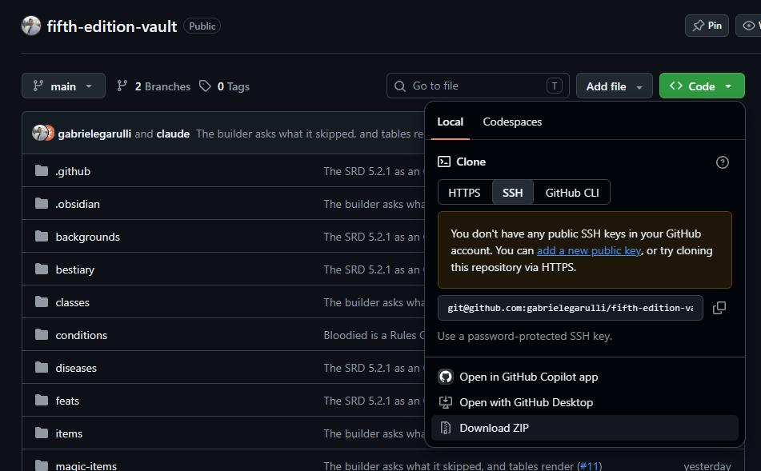

# Fifth Edition Vault

Fifth Edition Vault is a community extension. It is not made, endorsed or supported by Atlas VTT or Atlas Online. [Get support here](https://github.com/gabrielegarulli/fifth-edition-vault/issues).

https://github.com/user-attachments/assets/8324a97e-545c-4f63-bbf2-92d500a11b08

An Obsidian vault holding the **System Reference Document 5.2.1** as linked
notes, with a plugin installed to browse it and build characters. Fifth edition
compatible.

This is an early release for testing. Please [report what you find](../../issues).

## Using it

Fifth Edition Vault isn't in Obsidian's **Community plugins** browser yet, so
you can't install it from inside Obsidian. You install it by hand instead. It
takes about ten minutes and needs no technical knowledge: you download a folder
and copy a few things.

### Before you start

You need **Obsidian 1.11.4 or later on a computer** (Windows, macOS or Linux).
The plugin doesn't run on phones or tablets.

To check your version, open Obsidian's **Settings** (the gear icon at the bottom
left) and choose **General**. The version is at the top. If it's older than
1.11.4, click **Check for updates**.

### Step 1: Download it

1. Go to <https://github.com/gabrielegarulli/fifth-edition-vault>. You don't
   need a GitHub account.
2. Click the green **Code** button, then **Download ZIP** at the bottom of the
   menu that opens. You can ignore everything else in that menu.

   

3. Unzip the file (`fifth-edition-vault-main.zip`, in your Downloads folder):
   - **Windows:** right-click it → **Extract All…** → **Extract**.
   - **macOS:** double-click it.

You now have a folder called `fifth-edition-vault-main`. Inside it are the rules
folders (`spells`, `bestiary`, …) and the plugin.

### Step 2: Pick one of the two ways

- **[A. Open it as a new vault](#a-open-it-as-a-new-vault)**: the easiest. Pick
  this if you're new to Obsidian, or happy to keep the rules in a vault of their
  own.
- **[B. Add it to a vault you already have](#b-add-it-to-a-vault-you-already-have)**:
  pick this if you want the rules and the plugin next to your own campaign notes.

#### A. Open it as a new vault

1. Move the `fifth-edition-vault-main` folder somewhere you'll keep it, such as
   your Documents folder. Obsidian uses the folder where it is, so if it stays in
   Downloads and you clear that out later, the vault goes with it. You can
   rename the folder, for example to `Fifth Edition Vault`.
2. Open Obsidian. If a vault is already open, click the vault's name at the
   bottom left and choose **Manage vaults…**.
3. Next to **Open folder as vault**, click **Open**, and select the folder.
4. Obsidian asks whether you trust the author of this vault. Choose **Trust
   author and enable plugins**. (The warning appears for every vault that comes
   with plugins. This one never contacts a server.)

That's it. Go to [Step 3](#step-3-open-it).

#### B. Add it to a vault you already have

The plugin reads the rules from folders with fixed names at the **top level of
your vault** (`spells`, `bestiary`, …). So you copy two things: the plugin, and
those folders.

1. **Back up your vault.** Copy your whole vault folder somewhere safe. Nothing
   below should touch your notes, but a backup costs nothing.
2. **Check for name clashes.** If your vault already has a top-level folder
   called `backgrounds`, `bestiary`, `classes`, `conditions`, `diseases`,
   `feats`, `items`, `magic-items`, `species`, `spells`, `subclasses` or
   `variant-rules`, rename yours first (for example to `spells (mine)`).
   Otherwise the rules notes get mixed into it.
3. **Show hidden folders.** The plugin lives in a folder called `.obsidian`.
   Your computer hides names that start with a dot.
   - **Windows 11:** in File Explorer, **View → Show → Hidden items**.
     (Windows 10: the **View** tab → tick **Hidden items**.)
   - **macOS:** in Finder, press **Cmd + Shift + .** (the full stop key).
   - **Linux:** press **Ctrl + H** in most file managers.
4. **Find your vault folder.** In Obsidian, right-click a note in the left
   sidebar and choose **Show in system explorer** (Windows) or **Reveal in
   Finder** (macOS). Your vault folder is the one with `.obsidian` directly
   inside it. If you see no `.obsidian`, go up a folder until you do.
5. **Copy the plugin.**
   1. In the downloaded `fifth-edition-vault-main` folder, open `.obsidian`,
      then `plugins`. Copy the `fifth-edition-vault` folder.
   2. In your vault folder, open `.obsidian`. If there's no `plugins` folder
      inside it, make one and name it exactly `plugins`.
   3. Paste `fifth-edition-vault` into `plugins`.

   You should end up with `.obsidian/plugins/fifth-edition-vault/main.js` in
   your vault, with `manifest.json` and `styles.css` beside it. **Don't copy the
   whole `.obsidian` folder**: it would replace your own Obsidian settings.
6. **Copy the rules.** In the downloaded folder, select the 12 rules folders and
   the 12 `.base` files (`Spells.base`, `Bestiary.base`, …). Copy them and paste
   them into your vault folder, next to `.obsidian`, not inside it. You don't
   need the other files (`README.md`, `LICENSE`, `.github` and so on).
7. **Turn the plugin on.** In Obsidian, open **Settings → Community plugins**.
   1. If you see a **Turn on community plugins** button, click it.
   2. Under **Installed plugins**, find **Fifth Edition Vault** and switch its
      toggle on. If it isn't in the list, click the circular-arrow icon to
      reload the list, or close and reopen Obsidian.

### Step 3: Open it

Click the **die icon** in the ribbon, the narrow strip of icons on the far left
of Obsidian (hovering over it shows **Open Fifth Edition Vault**). You can also
press **Ctrl + P** (**Cmd + P** on a Mac), type `Fifth Edition Vault` and press
Enter.

### If something goes wrong

- **The plugin isn't in the list, or there's no die icon.** Check the folder
  is exactly `.obsidian/plugins/fifth-edition-vault/` with `main.js` directly
  inside it, not inside another folder of the same name. Then reload the list or
  restart Obsidian.
- **"Failed to load plugin".** Your Obsidian is older than 1.11.4. Update it
  (see [Before you start](#before-you-start)).
- **The plugin opens but the lists are empty.** The rules folders aren't at the
  top level of your vault, or have been renamed. Put them back next to
  `.obsidian` with their original names.
- **Anything else:** [open an issue](../../issues) and say what you did and
  what you saw. A screenshot helps.

### Updating

Until the plugin is in Community plugins, updates are by hand too. Download the
ZIP again (Step 1) and copy **only** the `.obsidian/plugins/fifth-edition-vault`
folder over your old one, replacing the files when asked. Then restart
Obsidian. Your plugin settings are kept: they live in a `data.json` file that
the download doesn't include.

Don't paste the rules folders over notes you have edited: that would replace
your edits.

### Rolling dice in Atlas VTT

Rolls go through the [Atlas VTT](https://atlas-vtt.dev) plugin when it is
installed. It isn't included here, and nothing else is needed to read the
catalogs or build a character.

Atlas VTT is a separate project with its own licence. This plugin contains none
of its code and only calls it inside Obsidian. If a roll goes wrong, please
[report it here](../../issues), not to Atlas VTT.

## What's in it

| Folder | Notes | | Folder | Notes |
| :--- | ---: | :--- | :--- | ---: |
| `spells` | 339 | | `feats` | 17 |
| `bestiary` | 336 | | `conditions` | 15 |
| `magic-items` | 339 | | `classes` / `subclasses` | 12 / 12 |
| `items` | 236 | | `species` / `backgrounds` | 9 / 4 |
| `variant-rules` | 119 | | `diseases` | 3 |

Each folder has a Bases view at the root (`Spells.base`, `Bestiary.base`, …).

**The notes are generated, not hand-written.** Where the SRD renames an entry,
the SRD's name is used (Arcane Hand, Handy Haversack, Instant Fortress). Each
note carries an `export_hash`, so a later export leaves a note you have edited
alone.

**The plugin never contacts a server.** Everything it shows comes from the notes
in this vault.

## How close to the SRD it is

The text was generated from a third-party dataset, keeping only entries it marks
as SRD 5.2, and then corrected against the SRD 5.2.1 PDF. On 2026-11-05 every
sentence in the notes was compared with that PDF:

- About 94% of the 5,923 prose sentences match the SRD at 90% or better, and 97%
  of the stat block text does.
- The rest are mainly lines this vault generates ("You gain a feature from your
  Fighter Subclass"), one note per variant of a single SRD table entry, or small
  rewordings.
- A few short sentences state an SRD rule in other words, mostly on ammunition
  and holy symbols.

So this is **not a word-for-word copy of the SRD**. If you need the exact text,
use the [SRD itself](https://www.dndbeyond.com/srd). If you find a passage that
isn't in the SRD, please open an issue and it will be removed.

The tactical and referee guidance on condition pages is this project's own
writing.

## License

- **The notes** are under the [Creative Commons Attribution 4.0 International
  License](LICENSE), as the SRD is.
- **The plugin** in `.obsidian/plugins/fifth-edition-vault` is under the
  [MIT License](.obsidian/plugins/fifth-edition-vault/LICENSE), with
  [third-party notices](.obsidian/plugins/fifth-edition-vault/THIRD_PARTY_NOTICES.md).

## Attribution

This work includes material from the System Reference Document 5.2.1 ("SRD
5.2.1") by Wizards of the Coast LLC, available at
https://www.dndbeyond.com/srd. The SRD 5.2.1 is licensed under the Creative
Commons Attribution 4.0 International License, available at
https://creativecommons.org/licenses/by/4.0/legalcode.

The SRD's text has been changed here: it is split into one note per entry,
formatted as Markdown with links and properties, and some entries are divided
into variants.

This project is unofficial. It is not made, endorsed or supported by Wizards of
the Coast, Atlas VTT or Atlas Online.

Atlas VTT and Atlas Online are product names of Fabian Urbanek. They appear here
only to say what this plugin works with.
